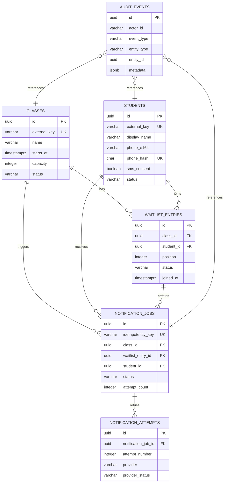

# Architecture: Class Waitlist SMS Notification Job

**Ticket:** ENG-135180  
**Scope:** Capstone 1 architectural planning; no feature code

## 1. Goals and assumptions

The system allows authorized floor staff to manage a class waitlist and create SMS notification jobs when seats become available. A notification job must be safe to retry, observable, and independent of the external Twilio service. The Twilio integration is a mock adapter in this phase.

Assumptions:

- A student can appear only once on a given class waitlist.
- Waitlist position is determined by `position`, with earlier position winning. Promotion is transactional and must not create duplicate notifications.
- Phone numbers are normalized to E.164 before persistence; the raw value is never stored.
- Notification text is treated as untrusted input. The API validates length and stores sanitized text; clients must render it as text, never HTML.
- UTC is used for all timestamps.
- A soft lifecycle model is preferred over destructive deletion for operational records.

## 2. Relational schema

PostgreSQL is the target relational database. UUIDs are generated server-side. All tables include `created_at` and `updated_at` unless noted.

### `classes`

| Column | Type | Constraints |
|---|---|---|
| `id` | uuid | PK |
| `external_key` | varchar(100) | NOT NULL, UNIQUE |
| `name` | varchar(200) | NOT NULL |
| `starts_at` | timestamptz | NOT NULL |
| `capacity` | integer | NOT NULL, CHECK > 0 |
| `status` | varchar(20) | NOT NULL, CHECK in `scheduled`, `active`, `completed`, `cancelled` |
| `created_at`, `updated_at` | timestamptz | NOT NULL |

Index: `(status, starts_at)`.

### `students`

| Column | Type | Constraints |
|---|---|---|
| `id` | uuid | PK |
| `external_key` | varchar(100) | NOT NULL, UNIQUE |
| `display_name` | varchar(200) | NOT NULL |
| `phone_e164` | varchar(20) | NOT NULL |
| `phone_hash` | char(64) | NOT NULL, UNIQUE |
| `sms_consent` | boolean | NOT NULL DEFAULT false |
| `status` | varchar(20) | NOT NULL, CHECK in `active`, `opted_out`, `blocked` |
| `created_at`, `updated_at` | timestamptz | NOT NULL |

The hash supports duplicate detection without exposing the phone number in logs. Encrypt `phone_e164` at rest using the deployment's secret-management facility.

### `waitlist_entries`

| Column | Type | Constraints |
|---|---|---|
| `id` | uuid | PK |
| `class_id` | uuid | NOT NULL FK `classes.id` |
| `student_id` | uuid | NOT NULL FK `students.id` |
| `position` | integer | NOT NULL, CHECK > 0 |
| `status` | varchar(20) | NOT NULL, CHECK in `waiting`, `notified`, `enrolled`, `removed`, `expired` |
| `joined_at` | timestamptz | NOT NULL |
| `removed_at` | timestamptz | NULL |
| `created_at`, `updated_at` | timestamptz | NOT NULL |

Unique constraint: `(class_id, student_id)`. Unique partial index on `(class_id, position)` for active statuses `waiting` and `notified`. Index `(class_id, status, position)`.

### `notification_jobs`

| Column | Type | Constraints |
|---|---|---|
| `id` | uuid | PK |
| `idempotency_key` | varchar(200) | NOT NULL, UNIQUE |
| `class_id` | uuid | NOT NULL FK `classes.id` |
| `waitlist_entry_id` | uuid | NOT NULL FK `waitlist_entries.id` |
| `student_id` | uuid | NOT NULL FK `students.id` |
| `channel` | varchar(20) | NOT NULL, CHECK = `sms` |
| `message` | varchar(500) | NOT NULL |
| `status` | varchar(20) | NOT NULL, CHECK in `queued`, `processing`, `sent`, `failed`, `cancelled` |
| `attempt_count` | integer | NOT NULL DEFAULT 0, CHECK >= 0 |
| `available_at` | timestamptz | NOT NULL |
| `last_error_code` | varchar(80) | NULL |
| `last_error_message` | varchar(500) | NULL |
| `provider_message_id` | varchar(200) | NULL |
| `sent_at` | timestamptz | NULL |
| `created_at`, `updated_at` | timestamptz | NOT NULL |

Index: `(status, available_at)` for workers; `(class_id, created_at)` for staff history. Never log message bodies or phone numbers.

### `notification_attempts`

| Column | Type | Constraints |
|---|---|---|
| `id` | uuid | PK |
| `notification_job_id` | uuid | NOT NULL FK `notification_jobs.id` |
| `attempt_number` | integer | NOT NULL, CHECK > 0 |
| `provider` | varchar(30) | NOT NULL DEFAULT `twilio_mock` |
| `provider_status` | varchar(40) | NOT NULL |
| `request_fingerprint` | char(64) | NOT NULL |
| `error_code` | varchar(80) | NULL |
| `created_at` | timestamptz | NOT NULL |

Unique constraint: `(notification_job_id, attempt_number)`. Retain for operational audit, with a documented retention period and restricted access.

### `audit_events`

| Column | Type | Constraints |
|---|---|---|
| `id` | uuid | PK |
| `actor_id` | varchar(100) | NOT NULL |
| `event_type` | varchar(100) | NOT NULL |
| `entity_type` | varchar(50) | NOT NULL |
| `entity_id` | uuid | NOT NULL |
| `metadata` | jsonb | NOT NULL DEFAULT `{}` |
| `created_at` | timestamptz | NOT NULL |

Index: `(entity_type, entity_id, created_at)` and `(event_type, created_at)`. Metadata must be allow-listed and redacted.

## 3. ERD

## 4. Reliability, security, and UX requirements

- Use a database transaction with row locking when promoting a waitlist entry and creating a job.
- Require an idempotency key on mutation endpoints. Repeating a request returns the original result, not a second job.
- Retry transient provider/network failures with exponential backoff and jitter. Mark permanent validation, consent, and blocked-number failures as `failed` without retry.
- The worker claims jobs using `SELECT ... FOR UPDATE SKIP LOCKED`; a lease timeout returns abandoned `processing` jobs to `queued`.
- Sanitize/normalize text before state or persistence: trim whitespace, enforce maximum lengths, reject control characters, and escape on output. Do not rely on sanitization as a substitute for parameterized queries.
- Never include phone numbers, message bodies, access tokens, or provider secrets in logs. Configuration comes from environment/secret storage.
- The future interface must show a loading indicator for every asynchronous operation, an explicit “No data found” empty state, and inline red validation errors tied to inputs with `aria-describedby`. All controls require accessible names and keyboard operation.
- After a primary action succeeds, emit exactly: `[Analytics] User interacted with Class Waitlist SMS Notification Job (Twilio Mock)`. This is a simulation only and must not send data to a third party.
- Use monochromatic semantic tokens (`surface`, `text`, `muted`, `border`, `danger`, `focus`) rather than arbitrary hex values; use 16px and 32px spacing steps.

## 5. Retention and recovery

Define retention with the client before production. A reasonable default is short retention for message/error detail, longer retention for aggregate audit events, and legal/consent records retained as required by policy. Provide an operator action to replay failed jobs only when the idempotency and consent checks pass.
